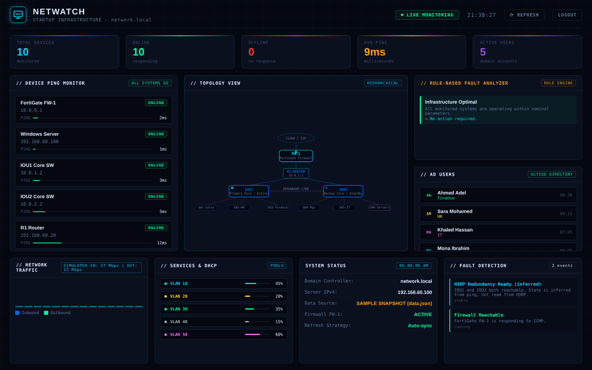
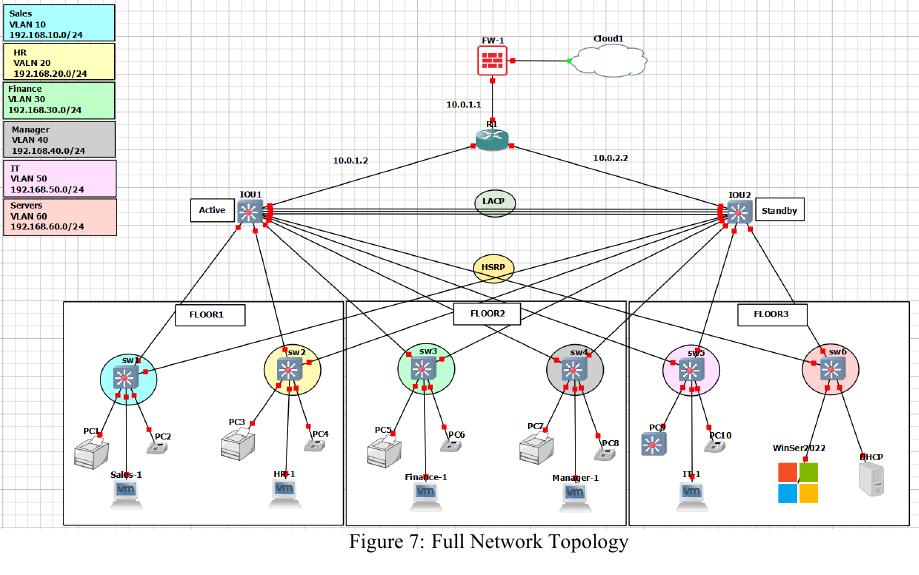

# NetWatch: Secure Enterprise Network & Monitoring Dashboard

> Graduation project (TM471), Arab Open University - Egypt, Cyber Security Department, 2025/2026.
> A secure, highly-available network for a startup company, built and tested in **GNS3**, with a lightweight **Python + web dashboard** for device monitoring and fault detection.



*Dashboard rendering the bundled sample snapshot (`dashboard/data.json`).*

## The problem

Many startups run a flat, unmanaged network: no central login, no segmentation, weak firewall policy, and no visibility when something fails. NetWatch designs and validates a layered alternative.

## What was built



| Layer | Implementation |
|---|---|
| **Identity** | Windows Server 2022: Active Directory (Users, Groups, OUs), DNS, GPOs, password policy |
| **Perimeter** | FortiGate firewall: WAN/LAN interfaces, static routes to the VLANs, per-department policies (IT, Manager, HR, Sales, Finance), LAN-to-WAN policy with NAT |
| **Segmentation** | 6 VLANs with inter-VLAN routing and DHCP |
| **High availability** | Two core switches (IOU1/IOU2) with **HSRP**, **RSTP** (IOU1 as root bridge), **EtherChannel/LACP** between the cores, floating static route for upstream failover |
| **Monitoring** | Python backend (ICMP polling, alert generation) + HTML/CSS/JS dashboard with a rule-based fault analyzer |

| VLAN | Department | Subnet | HSRP gateway |
|---|---|---|---|
| 10 | Sales | 192.168.10.0/24 | 192.168.10.1 |
| 20 | HR | 192.168.20.0/24 | 192.168.20.1 |
| 30 | Finance | 192.168.30.0/24 | 192.168.30.1 |
| 40 | Manager | 192.168.40.0/24 | 192.168.40.1 |
| 50 | IT | 192.168.50.0/24 | 192.168.50.1 |
| 60 | Servers | 192.168.60.0/24 | 192.168.60.1 |

## Validation

Tested in GNS3 (details and screenshots in the report):

| Test | Result |
|---|---|
| Inter-VLAN routing | Routing tables verified, cross-VLAN pings succeed where policy allows |
| HSRP failover | Standby gateway became active when the primary failed |
| RSTP | Stable forwarding paths, correct root bridge |
| EtherChannel/LACP | Port-channel stayed up with a member link down |
| Firewall | Internal hosts reach the internet through FortiGate (NAT) |
| DHCP / domain login | Clients receive correct addressing and authenticate against AD |
| Fault detection | Alerts raised for unresponsive devices |

## The dashboard: what is live and what is not

| Panel | Data source |
|---|---|
| Device status and latency | **Live**: ICMP ping of 10 lab devices every 10 s |
| Alerts and rule-based fault analyzer | **Live**: derived from the ping results |
| HSRP / firewall status | **Inferred** from reachability of IOU1, IOU2 and FortiGate (HSRP is not queried) |
| AD users | **Live** via PowerShell `Get-ADUser` when the backend runs on the domain controller (or a host with RSAT); otherwise **sample data** |
| DHCP pool usage | **Live** via the DHCP Server cmdlets when available; otherwise **sample data** |
| Network traffic chart | **Simulated** (demo only) |

The backend writes a `sources` block into `data.json` and the dashboard shows which parts are live.

## Run it

**Demo (any OS, no lab needed)**
```bash
cd dashboard
python -m http.server 8000
# open http://localhost:8000
```
Login (demo only): `admin` / `1234@`. The login runs in the browser, so it only demonstrates the UI flow and is **not** real authentication.

**With the backend (lab network)**
```bash
pip install -r requirements.txt
python network_monitor.py --output dashboard/data.json      # loop every 10 s
python network_monitor.py --once --output /tmp/data.json    # single scan
```
Edit the `DEVICES` list at the top of `network_monitor.py` to match your addressing. Works on Windows and Linux. AD/DHCP queries need PowerShell with the corresponding modules. Do not commit the `data.json` your backend overwrites.

## Repository layout

```
dashboard/            index.html, style.css, app.js, data.json (sample snapshot)
network_monitor.py    ICMP polling, AD/DHCP queries, alert generation
docs/                 full project report (PDF) and screenshots
```

## Limitations and future work

- Everything ran in a simulated environment; hardware effects were not tested.
- No automated off-site backup or disaster recovery.
- Remote-access VPN (IPsec/SSL on FortiGate) is planned, not deployed.
- Next steps: forward FortiGate and Windows Event logs to a SIEM (Splunk, ELK, FortiAnalyzer), query HSRP state via SNMP, real traffic counters, and server-side authentication.

## Author

**Roaa Ramadan Ahmed**, Junior Cybersecurity Engineer
[LinkedIn](https://linkedin.com/in/roaaramadan) | [LetsDefend](https://app.letsdefend.io/user/roaa33)
